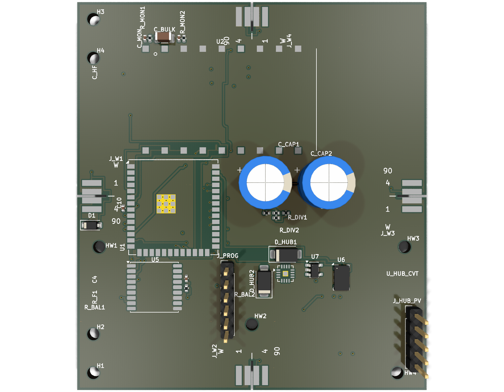
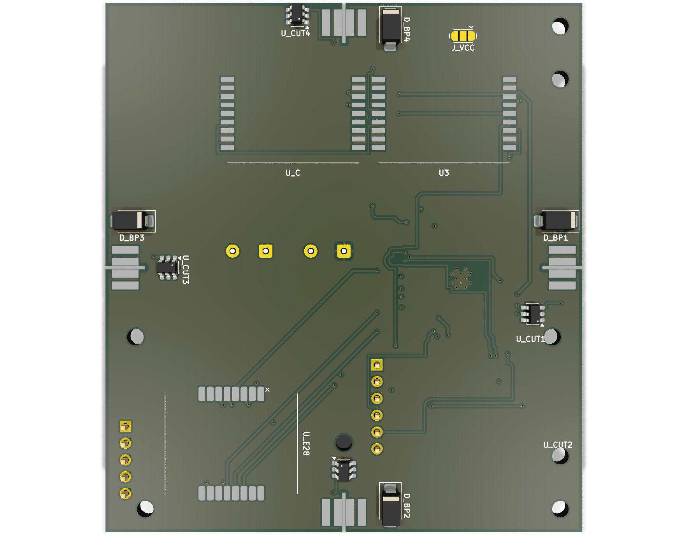
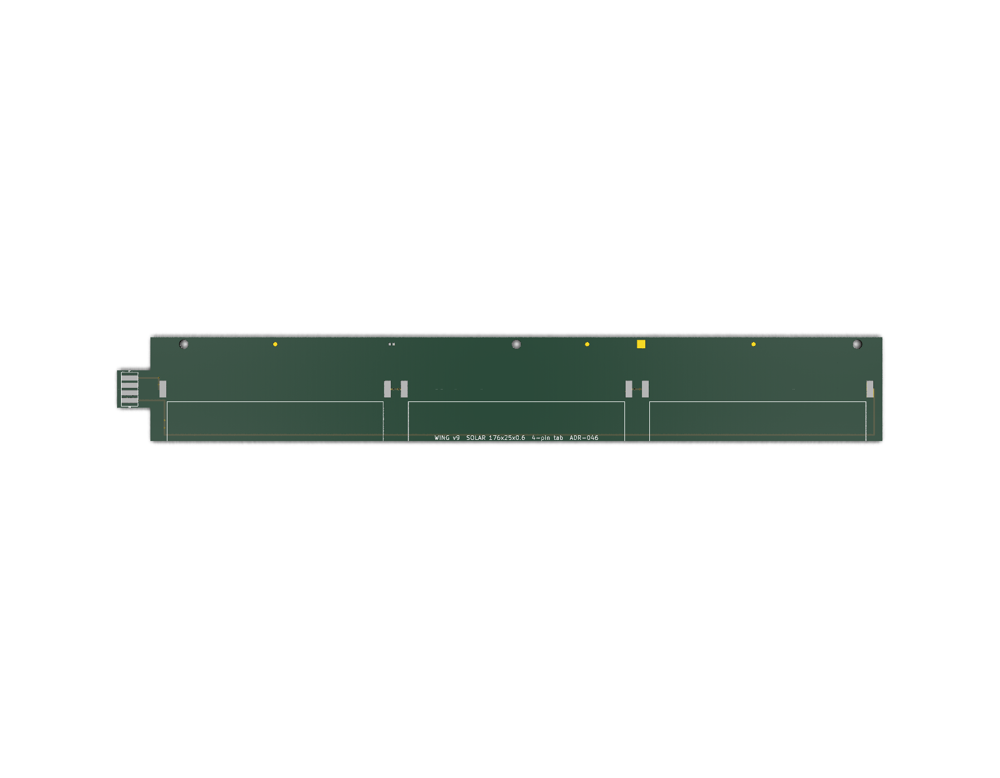
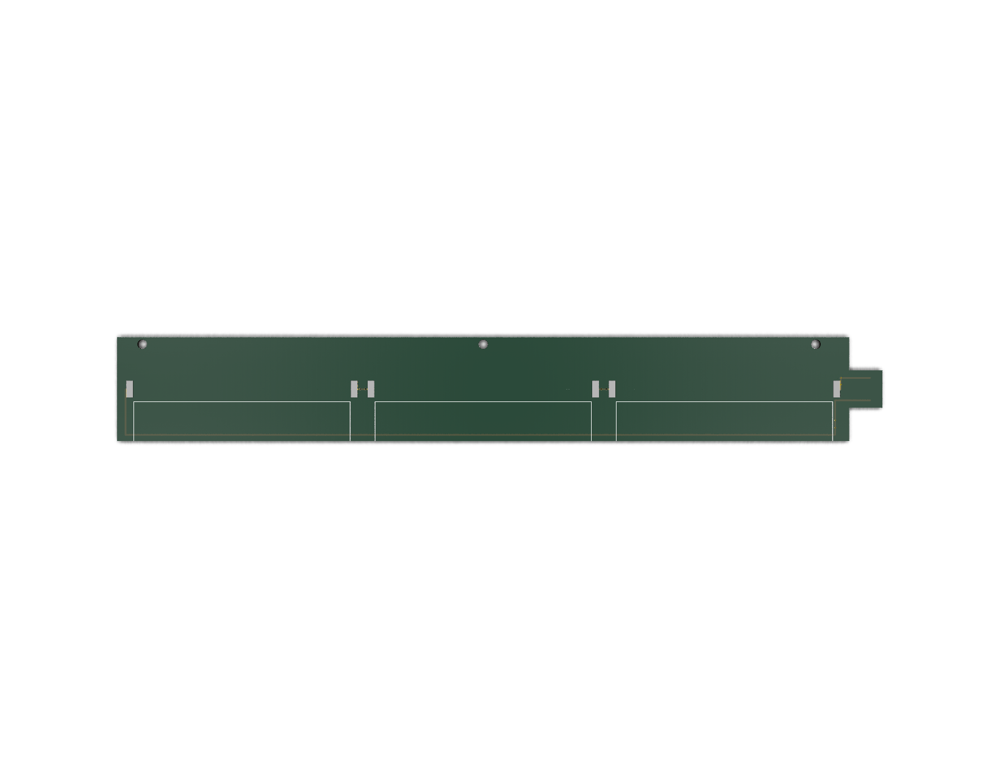

# v10 — Hub board status

**Board:** `hub_board_v10.kicad_pcb` · 72.1 × 80.1 mm, 4-layer · 49 footprints · 54 nets
**Status:** 🔧 **FABRICATED, NOT COMPLETE.** 10 assembled boards ordered from JLCPCB (2026-11-09).
**Last measured:** 2026-11-11 on `origin/master` `ace09314`
**Supersedes:** the v10 sections of [`BOARD-STATUS.md`](BOARD-STATUS.md) (2026-10-25)

> This page is the v10 record. The next board is separate: **[v11 status](V11-STATUS.md)**.
> v11 has **no board file yet** — it is a specification.




*3D renders generated with `kicad-cli pcb render --side top|bottom --perspective` from the board
file, 2026-11-11. See "What the render does not show" below before reading anything into the empty
areas.*

---

## 1. Measured state

| quantity | value | how measured |
|---|---|---|
| outline | 72.1 × 80.1 mm | `pcbnew` `GetBoardEdgesBoundingBox()` |
| footprints | 49 | `pcbnew` |
| nets | 54 | `pcbnew` `GetNetCount()` |
| tracks | 782 | `pcbnew` `GetTracks()` |
| **unconnected items** | **82** | `kicad-cli pcb drc --format json` |
| **DRC violations** | **35** = 16 **ERROR** + 19 warning | same |
| error class | 16 × `copper_edge_clearance` | all in the `J_W2` wing-seat slot region, `x≈35.75–36.25, y≈74–80` and `x≈72, y≈40.25` |

Reproduce:

```bash
kicad-cli pcb drc --format json --severity-all -o /tmp/v10.json tracker/hardware/hub_board_v10.kicad_pcb
```

### What is actually wrong

- **82 nets are not fully routed.** The board has 782 track segments, so this is a substantially
  routed board with a remaining tail — not an empty one. It is **not complete** and the number is
  the honest headline.
- **All 16 errors are one defect, in one place.** `J_W2` carries `Edge.Cuts` graphics forming a slot
  cut into the board edge; copper does not keep out of a footprint's own edge cut. This is the
  documented B43 condition, not 16 independent problems.
- **ADR-134 removed `GND` and `RF_FEED` from the wing tab**, so the hub's 4-land interface is
  **superseded** and the hub was never updated to match. Routing the remaining nets against a
  superseded interface would be work done twice — which is why the remaining routing is
  deliberately parked rather than pushed.

---

## 2. What the render does not show — read this before sharing

The render looks **half empty**, and that is the **3D model library**, not the board.

These parts have **no 3D model in any installed KiCad library**, so they render as bare pads:

| ref | part | model that is missing |
|---|---|---|
| `U2` | NiceRF LoRa2021 (the radio) | `RF_Module.3dshapes/NiceRF_LoRa2021.wrl` |
| `U1` | ESP32-S3-WROOM-1U | `RF_Module.3dshapes/ESP32-S3-WROOM-1U.step` |
| `U5` | GNSS ublox MAX | `RF_GPS.3dshapes/ublox_MAX.step` |
| `U_HUB_CVT` | VQFN-16 | `Package_DFN_QFN.3dshapes/VQFN-16-1EP_3x3mm_P0.5mm_EP1.1x1.1mm.step` |
| `J_W1`–`J_W4`, `H1`–`H4`, `HW1`–`HW4`, `J_VCC` | connectors / mounts | no model block at all |

Measured with `scripts/model_resolution_census.py --check`: **34 model refs, 29 resolved, 5
unresolved**. `kicad-cli pcb render` **exits 0 and prints no warning** when a model is missing, so
this is silent — the pads simply appear empty.

**It is not a fault in the board and it is not "unpopulated".** The parts are in the BOM and in the
assembly plan; only their 3D bodies are absent. Those model files do not exist upstream — they are
not obtainable by configuring KiCad, and substituting a similar package would render a wrong part
silently, which is worse than an empty pad.

---

## 3. What was ordered

**10 assembled boards** (not bare), double-sided PCBA — **19 top, 4 bottom**.

| item | state |
|---|---|
| `U_C` | **DNP** — `U3` carries LoRa2021 function fully; `U_C` would be redundancy and its four control lines have no MCU end (ADR-145 fixes this in v11) |
| `/EN` + `/IO0` wires | **included** in the assembly plan |
| `D_BP1..4` | **BOTTOM side** — this is why double-sided assembly was required; a top-only order would have shipped four diodes missing |
| order channel | JLCONE desktop app (ADR — `ORDERING-CHANNEL-JLCONE.md`) |

Full order data: [`V10-JLCPCB-ORDER-SHEET-10BOARDS.md`](../V10-JLCPCB-ORDER-SHEET-10BOARDS.md) ·
Gerbers + CPL + BOM: `docs/fab/v10-order-double-sided/`

---

## 4. Second board in this generation — wing

| quantity | wing |
|---|---|
| board | `wing_board_v9.kicad_pcb`, 184.1 × 25.1 mm |
| footprints | 15 |
| tracks | 28 |
| **unconnected** | **0** ✅ |
| DRC violations | 37 = 0 **ERROR** + 37 warning |




**The wing is electrically complete — 0 unconnected, 0 error-severity violations.** It renders
almost bare because it is a **solar-array interconnect**: three large cell areas are hand-soldered
solar cells, not placed parts. Its 3D coverage is **12/12 models resolved** (the only absences are
three mounting holes, which legitimately have no body).

If you want one board to represent this generation honestly in a single image, **the wing is the
finished one**.

---

## 5. Honest summary

- ✅ Fabricated, 10 assembled boards, real order data and gerbers in-repo.
- ✅ Wing board is electrically complete (0 unconnected).
- ⚠️ **Hub has 82 unconnected nets and 16 DRC errors — it is not a finished design.**
- ⚠️ Hub renders partially empty due to 5 missing 3D models + connectors with no model block.
- ⚠️ Hub's 4-land wing interface is superseded by ADR-134 and has not been updated.
- ❌ Not flight-ready; no flight has been flown with these boards.
