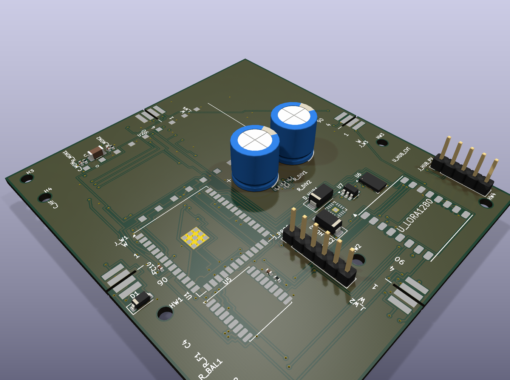
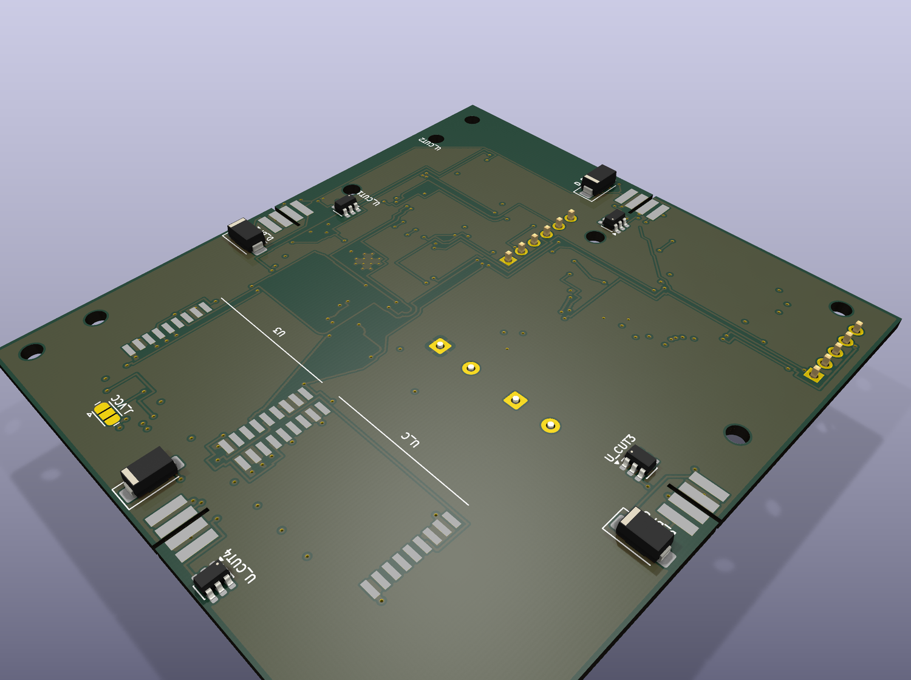

# v10 — hub board status (ORDERED)

**Ordered from JLCPCB: 10 assembled boards, double-sided PCBA (2026-11-09).**
This is the board that was actually fabricated. It is **not** a finished design, and this page says
so plainly rather than letting a reader discover it later.

| | |
|---|---|
| Board of record | `docs/analysis/bulk-route-20261107/latest.kicad_pcb` (git blob `92ff3705`) |
| Outline | **72.1 × 80.1 mm** |
| Copper layers | 4 |
| Footprints | 49 |
| Nets | 54 |
| Components fitted by JLCPCB | **23** (19 top, 4 bottom) |
| Tracks / vias | 2931 segments / 161 vias |
| Drill | 196 holes, 4 tools (0.200 / 0.300 / 1.000 / 2.500 mm) |
| **DRC errors** | **0** |
| DRC warnings | 16 (11 footprint-library mismatch, 4 library issues, 1 dangling track) |
| **Unconnected items** | **12** |
| Assembly data | `docs/fab/v10-order-double-sided/cpl-jlc.csv` (23 placement rows) |

---

## 3D render — top side



19 components fitted here. The two tall blue parts are bulk storage capacitors; the black headers are
the programming and power-monitor connections.

---

## 3D render — bottom side



4 components fitted here — the `D_BP1`–`D_BP4` bypass diodes.

**This is why the order is double-sided assembly** rather than the cheaper single-sided option. A
single-sided order would have shipped with four diodes missing. That mistake was caught on
2026-11-09, before the order went out.

---

## Read this before judging the render

The render looks **partly empty**, and that is mostly the **3D model library**, not the board.

These parts have **no 3D model in any installed KiCad library**, so they render as bare pads:

| ref | part | model that is missing |
|---|---|---|
| `U2` / `U_LORA1280` | NiceRF LoRa2021 (the radio) | `RF_Module.3dshapes/NiceRF_LoRa2021.wrl` |
| `U1` | ESP32-S3-WROOM-1U | `RF_Module.3dshapes/ESP32-S3-WROOM-1U.step` |
| `U5` | GNSS ublox MAX | `RF_GPS.3dshapes/ublox_MAX.step` |
| `U_HUB_CVT` | VQFN-16 | `Package_DFN_QFN.3dshapes/VQFN-16-1EP_3x3mm_P0.5mm_EP1.1x1.1mm.step` |
| `J_W1`–`J_W4`, `H1`–`H4`, `HW1`–`HW4`, `J_VCC` | connectors / mounts | no model block at all |

Measured with `scripts/model_resolution_census.py --check`: **34 model refs, 29 resolved, 5
unresolved**. `kicad-cli pcb render` **exits 0 and prints no warning** when a model is missing, so
this is silent — the pads simply appear empty.

**It is not a board fault.** The parts are in the BOM and the assembly plan; only their 3D bodies
are absent. Those model files do not exist upstream, and substituting a similar package would
render a wrong part silently, which is worse than an empty pad.

Separately, several sites are genuinely **not populated in this order** — `U_C` is DNP (below), and
`J_W1`–`J_W4` ship as solder pads for hand-fitted parts.

---

## What is honestly open on this board

The board is fabricated and electrically clean, but it carries **12 unconnected items**:

| Net | Unconnected items | What it is |
|---|---|---|
| `GND` | 3 | isolated pour fragments not stitched |
| `/VSCAP` | 2 | storage-rail segments not joined |
| `/W3_SOLAR_N` | 2 | wing 3 solar return |
| `/W2_SOLAR_N` | 1 | wing 2 solar return |
| `/SPI2_SCK` | 1 | `U1.4` ↔ `U2.12` |
| `/F33_VSENSE` | 1 | the 43.7 mm dead run |
| `/EN` | 1 | flash-time only; no copper |
| `/IO0` | 1 | flash-time only; no copper |

*(12 items across 8 nets. Each item is one missing connection — the count is per item, not per
endpoint.)*

Three are known design risks accepted for this revision and carried into v11 as explicit fix items —
`/F33_VSENSE`, `/EN` and `/IO0`. The other five are unfinished routing (pour stitching and rail
joins).

**The 16 DRC warnings are all library-metadata**, not electrical: 11 `lib_footprint_mismatch`, 4
`lib_footprint_issues`, 1 `track_dangling`. None is a clearance, short or edge violation.

### One known interface problem

**ADR-134 removed `GND` and `RF_FEED` from the wing tab**, so the hub's 4-land wing interface is
**superseded** and the hub was never updated to match (`docs/adr/134-wing-tab-two-pin-dead-copper-removal.md`).
That is a real open item for this generation, independent of the routing count.

---

## Which board file is the board of record — and why this matters

**Read this if you are comparing numbers against other documents on this project.**

`tracker/hardware/` contains three files named `hub_board_v10*`. **None of them is the ordered
board.** They are earlier or alternate builds, and they measure very differently:

| file | segments | vias | DRC errors | unconnected |
|---|---|---|---|---|
| **board of record** (`bulk-route-20261107/latest.kicad_pcb`, `92ff3705`) | **2931** | **161** | **0** | **12** |
| `tracker/hardware/hub_board_v10.kicad_pcb` (`d07b93d8`) | 730 | 52 | 16 | 82 |
| `tracker/hardware/hub_board_v10_lora1280_7of9.kicad_pcb` (`212d81b4`) | 843 | 41 | 18 | 86 |

The identifying evidence is the **shipped drill file**, not the filename: the order zip's `board.drl`
carries 196 holes at 0.200 / 0.300 / 1.000 / 2.500 mm, and only the board of record reproduces that
(188 PTH + 8 NPTH, same four diameters). A file checked by name alone reports the wrong board's DRC.

**Both sets of figures above are real; they describe different files.** An earlier version of this
page reported "82 unconnected, 35 violations, 16 errors" because it was measured on
`tracker/hardware/hub_board_v10.kicad_pcb`. Those 16 `copper_edge_clearance` errors are the `J_W2`
wing-seat slot defect in *that* file — and that file also never had them fixed. The fabricated board
does not carry them.

---

## What was ordered

**10 assembled boards** (not bare), double-sided PCBA — **19 top, 4 bottom**.

| item | state |
|---|---|
| `U_C` | **DNP** — `U3` carries the LoRa2021 function fully; `U_C` would be redundancy and its four control lines have no MCU end (ADR-145 fixes this in v11) |
| `/EN` + `/IO0` wires | **included** in the assembly plan |
| `D_BP1..4` | **BOTTOM side** — why double-sided assembly was required |
| order channel | JLCONE desktop app (`ORDERING-CHANNEL-JLCONE.md`) |

Full order data: [`V10-JLCPCB-ORDER-SHEET-10BOARDS.md`](../V10-JLCPCB-ORDER-SHEET-10BOARDS.md) ·
Gerbers + CPL + BOM: `docs/fab/v10-order-double-sided/`

---

## Second board in this generation — wing

| quantity | wing |
|---|---|
| board | `wing_board_v9`, **184.1 × 25.1 mm** |
| footprints | 15 |
| tracks | 28 |
| **unconnected** | **0** |
| DRC error-severity violations | **0** |


**The wing is electrically complete — 0 unconnected, 0 errors.** It renders almost bare because it is
a **solar-array interconnect**: three large cell areas are hand-soldered solar cells, not placed
parts. Its 3D coverage is **12/12 models resolved** (the only absences are three mounting holes,
which legitimately have no body).

*Measurement provenance: these wing figures were measured on the board file by a previous pass. The
`wing_board_v9.kicad_pcb` source is not currently in the repo — only its gerbers under
`tracker/hardware/output/gerbers_wing_v9/` — so they are quoted rather than re-derived here. They are
consistent with `BOARD-STATUS.md` (2026-10-25).*

---

## Honest summary

- ✅ Fabricated — 10 assembled boards, real order data and gerbers in repo.
- ✅ Board of record is **electrically clean: 0 DRC errors**.
- ✅ Wing board is electrically complete (0 unconnected, 0 errors).
- ⚠️ Hub carries **12 unconnected items** — pour stitching and rail joins, plus 3 accepted risks.
- ⚠️ Hub renders partly empty: 5 missing 3D models + connectors with no model block + DNP sites.
- ⚠️ Hub's 4-land wing interface is **superseded by ADR-134** and has not been updated.
- ❌ Not flight-ready. No flight has been flown with these boards, and none has been powered up or
  qualified.

---

### Reproduce

```bash
kicad-cli pcb drc --format json --units mm --severity-all \
  -o /tmp/v10-drc.json docs/analysis/bulk-route-20261107/latest.kicad_pcb
/usr/bin/python3 -c "
import json; d=json.load(open('/tmp/v10-drc.json'))
print('violations', len(d['violations']), 'unconnected', len(d['unconnected_items']))"
```

Renders: KiCad 9.0.9, `kicad-cli pcb render --quality high --floor --perspective`.

*Related: [v11 status](V11-STATUS.md) · [board status register](BOARD-STATUS.md) · [order sheet](../V10-JLCPCB-ORDER-SHEET-10BOARDS.md)*
